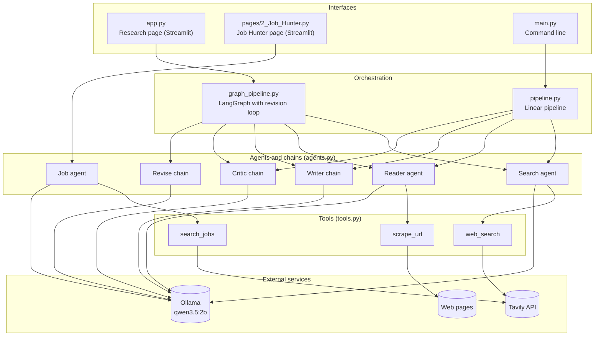
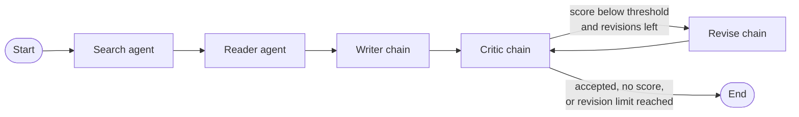
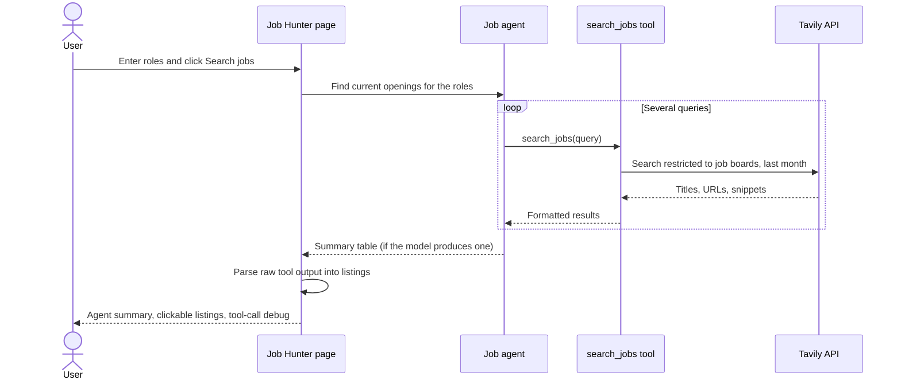

# LangChain Multi-Agent Research System

An AI-powered research assistant that turns a topic into a structured report, plus a job-hunting agent that finds current openings. A LangGraph pipeline searches the web, extracts content from a relevant page, drafts a report, and has a critic model review it, revising the draft until it passes. The project includes an interactive Streamlit interface and a command-line entry point.

## Features

- Search for recent information with Tavily.
- Scrape and extract readable page content with Trafilatura, Readability, and Beautiful Soup.
- Draft a report with an introduction, key findings, conclusion, and source URLs.
- Review the draft and return a score, strengths, areas to improve, and a verdict.
- Automatically revise the report when the critic's score is below a threshold you choose.
- Search job boards with a dedicated **job hunter agent** and list the openings it finds.
- Inspect every agent's tool calls and outputs in the web interface, and download the report as Markdown.

## Architecture



## Requirements

- Python 3.11
- [Ollama](https://ollama.com/) with the `qwen3.5:2b` model available locally
- A [Tavily API key](https://tavily.com/)

Key Python packages: `langchain`, `langchain-ollama`, `langgraph`, `streamlit`, `tavily-python`, `trafilatura`, `readability-lxml`, `beautifulsoup4`, `requests`, `python-dotenv`, `rich`. Everything is listed in `requirements.txt`.

## Setup

1. Clone the repository and move into its directory.
2. Create and activate a virtual environment:

   ```powershell
   py -3.11 -m venv .venv
   .venv\Scripts\Activate.ps1
   ```

   If PowerShell prevents activation, use `.\.venv\Scripts\python.exe` instead of `python` in the commands below.

3. Install the Python dependencies:

   ```powershell
   python -m pip install -r requirements.txt
   ```

4. Download the Ollama model:

   ```powershell
   ollama pull qwen3.5:2b
   ```

   Make sure the Ollama service is running before starting a run.

5. Create a `.env` file in the repository root and add your Tavily key:

   ```dotenv
   TAVILY_API_KEY=your_tavily_api_key
   ```

Keep the `.env` file private; do not commit API keys.

## Run the application

Start the Streamlit app from the repository root (the `src` imports require it):

```powershell
python -m streamlit run app.py
```

Streamlit opens with two pages in the sidebar:

| Page | What it does |
|---|---|
| **app** | Enter a research topic and run the full research pipeline |
| **Job Hunter** | Enter the roles you want and let the job agent search job boards |

To run the command-line pipeline instead:

```powershell
python main.py
```

The CLI uses the example topic defined in `main.py`, runs the linear pipeline (no revision loop), and prints each stage and its output.

## Research workflow

1. **Search agent** asks Tavily for up to five web results.
2. **Reader agent** selects a relevant URL from the results and extracts page content.
3. **Writer chain** combines the search results and extracted content into a structured report.
4. **Critic chain** reviews the report and returns a score and feedback.
5. **Revise chain** rewrites the report using the critic's feedback if the score is below the threshold and revisions remain. The critic then reviews the new draft.



If the critic's reply has no parsable `Score: X/10` line, the graph ends rather than looping blindly.

### Settings in the sidebar

| Setting | Meaning | Default |
|---|---|---|
| Characters passed to the Reader agent | How much of the search results the reader sees when choosing a URL | 2000 |
| Minimum critic score to accept | Scores below this trigger a revision | 7 |
| Max revision rounds | Upper limit on revise-and-review cycles | 2 |

### Results tabs

The research page shows per-step timings and these tabs: **Report** (with Markdown download and previous drafts), **Critic** (score history and feedback), **Search**, **Scraped**, and **Agent trace** (every tool call and tool output).

## Job hunter agent

A separate single agent that searches job boards and returns current openings. It runs independently of the research pipeline.



- **Tool:** `search_jobs` queries Tavily restricted to job boards (BrighterMonday, MyJobMag, LinkedIn, RemoteOK, We Work Remotely, Wellfound), limited to roughly the last month and up to eight results per query. Edit the `JOB_SITES` list in `src/tools/tools.py` to change the boards.
- **Prompt:** `JOB_PROMPT` in `src/agents/agents.py` tells the agent to run several different searches, show salaries in KES per month with approximate conversions, write "not listed" rather than invent a salary, and only cite URLs that appeared in tool results. Edit it to describe the roles and locations you want.
- **Model:** the job agent uses its own `job_llm` with a larger `num_predict` so it has room to write a results table.
- **Output:** the page shows the agent's summary when there is one, and always shows the raw listings parsed directly from the search tool, so you get results even if the model writes nothing. A debug expander lists the agent's tool calls.

Listings can be expired and snippets may not match the page, so open each link before applying.

## Project structure

```text
app.py                      Streamlit research page
main.py                     Command-line example
pages\2_Job_Hunter.py       Streamlit job hunter page
src\agents\agents.py        Ollama models, agents, and writing/review/revise chains
src\pipelines\pipeline.py   Linear pipeline used by the command line
src\pipelines\graph_pipeline.py
                            LangGraph pipeline with the revision loop
src\tools\tools.py          Tavily search, job search, and web-page extraction tools
requirements.txt            Python dependencies
```

## Troubleshooting

| Problem | Likely cause and fix |
|---|---|
| `FileNotFoundError` when importing `ollama` or `httpx` | The `SSL_CERT_FILE` environment variable points to a file that does not exist. Remove or correct it (`unset SSL_CERT_FILE` in Git Bash, or delete it in Windows environment variables). The Streamlit files also clear it at startup as a workaround. |
| Reports or revisions end abruptly | `num_predict=300` in `agents.py` caps output length. Raise it for the writer and critic. |
| An agent skips tools or returns nothing | Very small models are unreliable at tool calling. Check the Agent trace tab, and try a larger Ollama model. |
| `ModuleNotFoundError: src` | Run Streamlit from the repository root: `python -m streamlit run app.py`. |
| LinkedIn pages fail to scrape | LinkedIn often blocks scraping. The job agent relies on search snippets for this reason. |

## Notes

- The language model runs locally through Ollama; web search requires internet access and a valid Tavily API key.
- Research quality depends on the available search results and the pages that can be accessed and extracted. Review sources and verify important claims before relying on the generated report.
- The project is licensed under the Apache License 2.0; see [LICENSE](LICENSE).